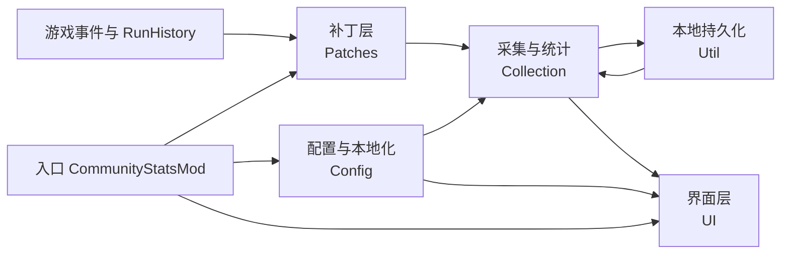

# 总体设计

- 版本：1.9.1（历史入口按钮放大）
- 更新时间：2026-11-25 03:36
- 关联需求：RQ-001 至 RQ-029

## 上下文与范围

本 Mod 以 DLL 形式加载进 Slay the Spire 2。它读取游戏运行时事件和本地 `RunHistory`，生成战斗贡献、生涯统计、概率提示和意图状态机 UI。它不修改游戏平衡，不写入游戏存档，不访问网络。

系统边界：

- 输入：游戏程序集事件、Harmony 补丁回调、`RunHistory`、用户设置文件。
- 输出：Godot UI 节点、`%AppData%/sts2_community_stats` 下的 JSON 统计文件。
- 不负责：游戏规则计算、存档格式、服务器通信、Workshop 发布。

## 架构总览



## 组件分解

| 组件 | 源码 | 职责 | 不负责 |
|---|---|---|---|
| 入口 | `src/CommunityStatsMod.cs` | 初始化配置、Harmony、后台缓存预热、热键与 UI 挂载 | 统计规则、补丁目标适配 |
| 配置 | `src/Config/` | 设置读写、功能开关、语言、筛选默认值 | 统计计算、UI 布局 |
| 采集与统计 | `src/Collection/` | 战斗贡献、局内汇总、生涯分析、缓存 | Harmony 目标选择、Godot 节点管理 |
| 补丁层 | `src/Patches/` | 把游戏事件转成采集调用；探测缺失目标 | 统计聚合、UI 绘制 |
| 界面层 | `src/UI/` | 面板、指示器、状态机图 | 直接修改游戏状态 |
| RitsuLib 集成 | `src/Settings/` | 设置页、配置绑定、运行时热键、设置变更后的 UI 刷新 | 统计逻辑、文件格式 |
| 对局身份 | `src/Collection/RunIdentity.cs` | 保存 StartTime、Seed、RunKey；判断身份是否有效 | 文件读写 |
| 对局存储 | `src/Util/RunStorage.cs` | 解析 RunKey 目录、文件名、meta.json；legacy 路径 | UI、设置 |
| 工具 | `src/Util/` | 异常隔离、持久化、布局、名称与意图元数据 | 业务规则决策 |

详细设计见 `002`、`003`、`004`。

## 依赖与分层

允许的依赖方向：

- `UI -> Collection -> Config/Util`
- `Patches -> Collection/Util`
- `Collection -> Config/Util`
- `Settings -> Config/Util`
- `Settings -> UI/Patches`：设置变更后刷新顶部指示器、贡献面板和意图面板
- `CommunityStatsMod -> 所有层`

禁止的依赖方向：

- `Collection` 不得引用 `UI` 或 `Patches`。
- `Util` 不得引用 `UI`、`Patches`；`CareerStatsCache` 可以引用 `Collection` 的数据模型用于序列化。
- `Config` 不得引用 `UI` 或 `Patches`。
- `Patches` 不得直接构造 Godot 面板；面板由 `UI` 提供入口。

静态检查方式：

```bash
rg -n "using CommunityStats\.UI" 9.SRC/src/Collection 9.SRC/src/Util 9.SRC/src/Config
rg -n "using CommunityStats\.Patches" 9.SRC/src/Collection 9.SRC/src/Util 9.SRC/src/Config
```

## 数据设计

### 内存状态

- `CombatTracker.Instance`：当前战斗的贡献累加、回合数、伤害上下文、AsyncLocal 来源上下文。
- `ContributionMap.Instance`：能力/遗物/药水来源、格挡池、减益层数、伤害修正、抽牌与费用标记。
- `RunContributionAggregator.Instance`：本局累计与每场战斗记录。
- `RunHistoryAnalyzer.Instance`：生涯统计缓存，键为角色、最低进阶、最近局数、对局模式。

### 持久化

| 路径 | 内容 | 写入者 |
|---|---|---|
| `%AppData%/sts2_community_stats/mod_prefs.json` | 用户设置 | `ModConfig.SaveSettings` |
| `%AppData%/sts2_community_stats/contributions/{StartTime}_{seed}/meta.json` | 对局身份 | `RunStorage` |
| `%AppData%/sts2_community_stats/contributions/{StartTime}_{seed}/combat_{floor}_{sequence}.json` | 单场贡献 | `ContributionPersistence` |
| `%AppData%/sts2_community_stats/contributions/{StartTime}_{seed}/summary.json` | 本局汇总 | `ContributionPersistence` |
| `%AppData%/sts2_community_stats/contributions/{StartTime}_{seed}/live.json` | 中途快照 | `ContributionPersistence` |
| `%AppData%/sts2_community_stats/contributions/{StartTime}_{seed}/shop_purchases.json` | 商店购买 | `ShopPurchasePersistence` |
| `%AppData%/sts2_community_stats/contributions/{StartTime}_{seed}/shop_offers.json` | 商店报价 | `ShopOfferingPersistence` |
| `%AppData%/sts2_community_stats/cache/` | 生涯统计缓存 | `CareerStatsCache` |

1.4.4 及更早的 `{seed}_*.json` 在正常 RunKey 路径只读回退，不自动迁移。`StartTime` 不可用时，当前实现会退化到 legacy 路径并可能写入或清理；这是已知限制，见“偏差与限制”。1.5.1 保留原版 90 天清理，legacy 扁平文件也按修改时间清理。

## 内部接口

| 接口 | 调用者 | 作用 |
|---|---|---|
| `CommunityStatsMod.Initialize()` | 游戏 Mod 加载器 | 初始化所有组件 |
| `CombatTracker.OnCombatStart/OnCombatEnd` | `CombatLifecyclePatch` | 建立/结束战斗上下文 |
| `CombatTracker.OnDamageDealt`、`OnBlockGained` 等 | 战斗、卡牌、遗物、能力补丁 | 记录贡献 |
| `RunHistoryAnalyzer.LoadAllAsync` | 入口与生涯 UI | 构建生涯快照 |
| `ContributionPanel.Instance` | 入口、战斗结束钩子 | 显示贡献面板 |
| `RitsuSettingsPage.Register` | `CommunityStatsMod.Initialize` | 注册 RitsuLib 设置页 |
| `HotkeyRegistration.InitializeAsync` | 入口，场景树就绪后 | 注册可重绑定贡献面板热键 |
| `RunIdentity.FromManager/FromHistory` | 运行生命周期、历史回放 | 建立对局身份 |
| `RunStorage.DirectoryFor/EnsureDirectory` | 持久化层 | 解析对局目录并写 meta |
| `IntentStateMachinePanel.Create` | `IntentHoverPatch` | 构建意图状态机面板 |
| `Safe.Run/RunAsync` | 所有补丁与 UI 回调 | 异常隔离 |

## 关键流程

### 战斗贡献

1. `CombatLifecyclePatch` 在战斗开始调用 `CombatTracker.OnCombatStart`。
2. 卡牌、遗物、药水、能力补丁写入 `CombatTracker` 与 `ContributionMap` 的来源上下文。
3. 伤害、格挡、抽牌、能量、治疗事件由对应补丁调用采集方法。
4. `ContributionPanel.OnCombatDataUpdated` 刷新面板。
5. 战斗结束时 `CombatTracker.OnCombatEnd` 生成快照，`ContributionPersistence` 写入磁盘，`RunContributionAggregator` 合并本局数据。
6. 无奖励事件战斗由 `CombatRoom.Exit` 前缀在 `CombatManager.Reset` 前触发同一保存；用于 `CombatEnded` 被提前退出路径跳过的场景。

### 生涯统计

1. 入口在后台调用 `RunHistoryAnalyzer.LoadAllAsync(null)`。
2. `RunHistoryAnalyzer` 读取 `RunHistory`，按本地玩家角色/进阶/最近局数/模式过滤；模式按 `GameMode` 名称匹配。
3. `CareerStatsSection` 从 `ModelDb.AllCharacters` 构建角色列表；v0.113 包含愚者，v0.111 自动省略。
4. 聚合胜率、死亡原因、路线、先古选项、Boss、卡牌与遗物统计。
5. 结果写入 `CareerStatsCache`，同时更新内存缓存。
6. `CareerStatsSection` 在百科大全角色数据页读取并渲染。

### 意图状态机

1. `IntentHoverPatch` 捕获生物聚焦与失焦。
2. `IntentStateMachinePanel.Create` 从 `MonsterIntentMetadata` 读取状态机。
3. 面板布局、箭头与图标由 `ArrowOverlay` 绘制。
4. 失焦、战斗结束或目标死亡时隐藏并清理面板。

## 状态与生命周期

- Mod 生命周期：`Initialize` 一次；Harmony 补丁常驻；UI 首次访问时懒加载。
- 运行生命周期：`RunLifecyclePatch` 在新建时调用 `RunDataCollector.BeginNewRun`，不加载旧文件；在续局时调用 `ResumeRun`，只加载当前 RunKey；在胜利、失败与放弃时统一调用收尾，重复收尾按 `RunKey` 拦截。
- 战斗生命周期：开始、回合、结束三个节点分别由补丁驱动。
- 缓存生命周期：生涯快照按需重算；RunHistory 内存缓存在失效时重建；设置中的 TTL 字段当前没有驱动清理。新对局目录与 legacy 扁平文件均按 90 天策略清理；该策略由 SP-057 允许。

## 算法与规则

- 贡献归因：直接伤害、能力/遗物修正、减益分摊、格挡池、治疗、抽牌、能量与费用减免分别累计。
- 格挡池按来源切片消耗，处理多来源叠加。
- 临时力量回滚使用补丁标记，避免把回滚量算成新增贡献。
- 生涯统计以 `RunHistory` 为唯一事实来源，不依赖服务器。
- 意图状态机使用图布局、强连通分量分层和箭头避让。

## 失败与降级

- `Safe.Run` 捕获异常并写入 `[StatsTheSpire]` 警告日志。
- `Safe.TryPatchFirst` 在目标缺失时记录警告，不抛出。
- 配置损坏时使用默认值。
- 缓存损坏时删除并重建；失败时返回空快照。
- UI 节点失效时重建或隐藏，不阻塞游戏主循环。

## 资源与构建视图

- 目标框架：`net9.0`。
- 依赖：游戏自带 `sts2.dll`、`GodotSharp.dll`、`0Harmony.dll`，以及 NuGet 包 `STS2.RitsuLib 0.6.14`。
- 构建属性：`STS2GameDir` 指向游戏安装目录。
- 运行时依赖：玩家安装完整的 `mods/STS2-RitsuLib/` 文件夹；本项目不复制 RitsuLib 程序集。
- 输出：`sts2_statsthespire_local.dll`，与 `manifest.json` 同目录。
- 不生成 `.deps.json`，避免游戏把 JSON 当作 Mod manifest 扫描。

## 需求追溯

| 需求 | 设计位置 |
|---|---|
| RQ-001 | 入口、配置；移除联网组件 |
| RQ-002 | 补丁层、构建视图 |
| RQ-003 | 构建属性与版本条件 |
| RQ-004 | 采集与统计、界面层 |
| RQ-005 | 失败与降级 |
| RQ-006 | 数据设计、持久化 |
| RQ-007 | 资源与构建视图 |
| RQ-008 | 测试计划与部署 |
| RQ-009 | README、ChangeLog、ADR |
| RQ-010 | RunHistory 兼容、界面层角色筛选 |
| RQ-011 | RitsuLib 集成、界面层、配置 |
| RQ-012 | 对局身份、对局存储、持久化 |

## 偏差与限制

- 1.5.0 已在 v0.111.1 与 v0.113.1 完成实机验证；暂停页、F8 物理按键与重启持久化仍待人工确认。
- 意图状态机元数据依赖游戏模型；新怪物可能缺少元数据，需要回退显示。
- 新角色「愚者」的 RunHistory 兼容性已在 v0.113.1 验证。
- 8 月 DLL 的 `RealTimeCombatPatch` 为空类，不纳入设计。

## 变更记录

| 时间 | 变更 |
|---|---|
| 2026-11-19 06:52 | 建立 1.4.0 总体设计 |
| 2026-11-20 00:30 | 1.5.0：加入 RunIdentity/RunStorage、RitsuLib 设置与热键、按 StartTime 分目录 |
| 2026-11-20 02:40 | 1.5.0：登记全结局统一收尾、双版本验证与人工验收限制 |
| 2026-11-20 04:08 | 1.5.1：确认 90 天清理覆盖新目录与 legacy 文件；登记设置损坏日志与 legacy 商店复制 |
| 2026-11-22 06:45 | 无奖励事件战斗保存改由 `CombatRoom.Exit` 兜底；第 45 层写出验证通过 |
